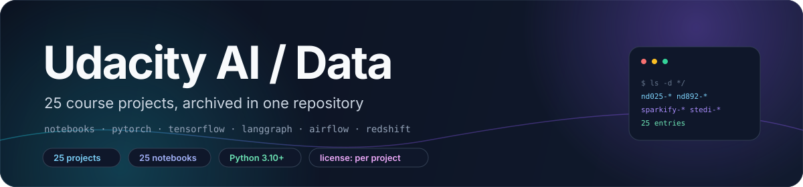
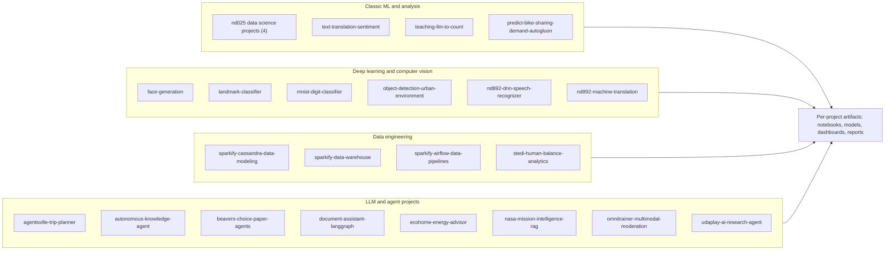

<div align="center">



# udacity-ai-data-projects

**Twenty-five Udacity AI, data-science and data-engineering course projects, archived in one repository.**

One directory per former repository · per-project READMEs · notebooks, scripts and committed artifacts · no shared build

[**简体中文**](README.zh-CN.md) · **English**

<a href="#-license--attribution"></a>
<a href="https://www.python.org/"></a>
<a href="docs/projects.md"></a>
<a href="docs/projects.md"></a>

</div>

> [!NOTE]
> **Current state.** This repository is an archive, not a library. Twenty-five course projects were
> consolidated here on 2026-10-21 from separate repositories that were deleted afterwards. There is no
> root `requirements.txt`, build, or test runner; each project directory stands on its own.

## ✨ Features

- **Twenty-five top-level projects.** Each directory is a former standalone repository imported with
  `git subtree`, so the per-project commit history is preserved in this tree.
- **Per-project documentation.** Every project keeps its own README (twenty-four at the directory root;
  `ecohome-energy-advisor/` keeps one at `ecohome_solution/`), and the root README only indexes them.
- **Notebook-first coursework.** 25 `.ipynb` files are committed, 18 of them carrying execution outputs;
  several projects also include the exported `.html` of the submitted notebook.
- **Script entry points where the rubric required them.** `run_demo.py`, `main.py`,
  `project_starter.py`, `run_gan.py`, `run_project.py`, `local_validation.py`,
  `scripts/run_examples.py`, and `report/dashboard.py` are all real, runnable files.
- **Mixed dependency eras.** The stack ranges from `keras==2.0.5` plus `tensorflow==1.1.0` in
  `nd892-dnn-speech-recognizer/` to Python 3.12 with `uv` in `omnitrainer-multimodal-moderation/`.
- **Committed artifacts.** Trained weights (`.h5`, `.pth`), a LoRA adapter, loss and reward curves,
  Athena screenshots, `metrics_summary.json` files, and one `outputs/inference_video.mp4`.
- **Cloud-dependent projects are documented, not offline-runnable.** Three Sparkify/STEDI projects
  target Redshift, Airflow or AWS Glue.
- **No secrets in the tree.** Configuration ships as `.env.example`, `env.example`, or a placeholder
  `dwh.cfg`; no keys or connection strings are committed.

## 🧠 Architecture

The repository is a collection of 25 independent projects. The map groups them by course track; per-project commands, artifacts, and limits are in [`docs/projects.md`](docs/projects.md).



## 🗂️ Modules

A dash in the course column means the project README does not name its program. Setup, run commands
and artifact notes for every row are in [`docs/projects.md`](docs/projects.md).

| Project | Course / module | Stack | Entry point |
|---|---|---|---|
| [`agentsville-trip-planner`](agentsville-trip-planner/) | Agentic AI nd900 · Core #6 | openai · pydantic · ReACT loop | `agentsville_trip_planner.ipynb` |
| [`autonomous-knowledge-agent`](autonomous-knowledge-agent/) | — | LangGraph · SQLite · pytest | `run_demo.py` |
| [`beavers-choice-paper-agents`](beavers-choice-paper-agents/) | Agentic AI · multi-agent sales | smolagents · SQLite · pandas | `project_starter.py` |
| [`document-assistant-langgraph`](document-assistant-langgraph/) | — | LangGraph · LangChain · pydantic | `main.py` |
| [`ecohome-energy-advisor`](ecohome-energy-advisor/) | — | LangGraph · ChromaDB · SQLite | `ecohome_solution/run_demo.py` |
| [`face-generation`](face-generation/) | Deep Learning nd101 · Course 5 | PyTorch · DCGAN · CelebA | `run_gan.py` |
| [`landmark-classifier`](landmark-classifier/) | Introduction to Deep Learning · Core #4 | PyTorch · ResNet50 · TorchScript | `cnn_from_scratch.ipynb` |
| [`mnist-digit-classifier`](mnist-digit-classifier/) | Introduction to Deep Learning | PyTorch · fully connected net | `mnist_digit_classifier.ipynb` |
| [`nasa-mission-intelligence-rag`](nasa-mission-intelligence-rag/) | — | ChromaDB · Streamlit · RAGAS | `streamlit run chat.py` |
| [`nd025-data-science-blog-post`](nd025-data-science-blog-post/) | Data Scientist nd025 · blog post | pandas · scikit-learn · CRISP-DM | `california_housing_blog_analysis.ipynb` |
| [`nd025-data-science-dashboard`](nd025-data-science-dashboard/) | Data Scientist nd025 · dashboard | FastHTML · SQLite · pytest | `report/dashboard.py` |
| [`nd025-data-science-pipeline`](nd025-data-science-pipeline/) | Data Scientist nd025 · pipeline | scikit-learn · TF-IDF · grid search | `Data_Science_Pipeline.ipynb` |
| [`nd025-recommendation-system`](nd025-recommendation-system/) | Data Scientist nd025 · recommendations | pandas · scikit-learn · SVD | `Recommendations_with_IBM.ipynb` |
| [`nd892-dnn-speech-recognizer`](nd892-dnn-speech-recognizer/) | NLP nd892 · ASR capstone | Keras 2.0.5 · TF 1.1.0 · librosa | `vui_notebook.ipynb` |
| [`nd892-machine-translation`](nd892-machine-translation/) | NLP nd892 · machine translation | Keras · seq2seq · LSTM/GRU | `machine_translation.ipynb` |
| [`object-detection-urban-environment`](object-detection-urban-environment/) | Self-Driving Car nd013 · Course 2 | TF 2 Detection API · Waymo frames | `1_train_model.ipynb` |
| [`omnitrainer-multimodal-moderation`](omnitrainer-multimodal-moderation/) | — | Pydantic AI · FastAPI · Gradio · uv | `uv run multimodal-moderation` |
| [`predict-bike-sharing-demand-autogluon`](predict-bike-sharing-demand-autogluon/) | AWS Machine Learning Engineer | AutoGluon Tabular · SageMaker | `Predict Bike Sharing Demand with AutoGluon.ipynb` |
| [`sparkify-airflow-data-pipelines`](sparkify-airflow-data-pipelines/) | Data Pipelines · Sparkify | Airflow · Redshift · S3 | `dags/final_project.py` |
| [`sparkify-cassandra-data-modeling`](sparkify-cassandra-data-modeling/) | Data Modeling · Cassandra | Cassandra · pandas | `project_1b_solution.py` |
| [`sparkify-data-warehouse`](sparkify-data-warehouse/) | Data Warehouse · Sparkify | Redshift · psycopg2 · boto3 | `etl.py` |
| [`stedi-human-balance-analytics`](stedi-human-balance-analytics/) | Data Engineering with AWS · STEDI | Glue · Athena · Spark | `local_validation.py` |
| [`teaching-llm-to-count`](teaching-llm-to-count/) | Generative AI nd608 · Fundamentals | TRL · PEFT · GRPO · Qwen2.5-0.5B | `run_grpo_mps.py` |
| [`text-translation-sentiment`](text-translation-sentiment/) | Deep Learning nd101 · Course 4 | transformers · MarianMT · DistilBERT | `run_project.py` |
| [`udaplay-ai-research-agent`](udaplay-ai-research-agent/) | — | ChromaDB · OpenAI · Tavily | `scripts/run_examples.py` |

## 🚀 Quick start

**Requirements:** Python 3.10+ for the recent projects, per each project README;
`omnitrainer-multimodal-moderation` requires Python 3.12. `nd892-dnn-speech-recognizer` still pins the
old Udacity environment (Python 3.5, `tensorflow==1.1.0`, `keras==2.0.5`).

There is no repository-level install step — no root `requirements.txt`, `pyproject.toml` or `Makefile`.
Clone once, then work inside one project directory:

```sh
git clone https://github.com/LeoLin990405/udacity-ai-data-projects.git
cd udacity-ai-data-projects/<project>
python3 -m venv .venv
. .venv/bin/activate
pip install -r requirements.txt
```

From the repository root, three projects run end to end without a cloud account:

```sh
# 1. LangGraph support agent — SQLite demo, no API key
cd autonomous-knowledge-agent
python setup_database.py && python run_demo.py && python -m pytest -q

# 2. Document assistant — falls back to FakeDocumentLLM when no key is set
cd document-assistant-langgraph
cp .env.example .env && python main.py

# 3. Employee-events dashboard — tests, package build, then http://localhost:5001
cd nd025-data-science-dashboard
pip install -r requirements.txt && pytest && python report/dashboard.py
```

Projects that need an account, key or AWS resource: `sparkify-data-warehouse` (Redshift cluster),
`sparkify-airflow-data-pipelines` (Airflow plus Redshift and S3), `stedi-human-balance-analytics`
(Glue and Athena), `agentsville-trip-planner` (OpenAI-compatible endpoint), and `nasa-mission-intelligence-rag`,
`udaplay-ai-research-agent`, `omnitrainer-multimodal-moderation` (provider keys).

> [!TIP]
> Several projects ship a deterministic fallback so the workflow is inspectable without credentials:
> `FakeDocumentLLM` in `document-assistant-langgraph/`, mock weather and price tools with local
> embeddings in `ecohome-energy-advisor/`, and a local embedding fallback in `udaplay-ai-research-agent/`.

## 📊 Reported results

Every figure below is the value recorded in that project's own README, notebook, or JSON artifact.
Nothing was re-run for this documentation pass.

| Project | Reported result | Source |
|---|---|---|
| `mnist-digit-classifier` | 97.05% test accuracy (784 → 256 → 128 → 10, 15 epochs) | project README |
| `nd025-data-science-pipeline` | accuracy 0.8897 · precision 0.9680 · recall 0.8944 · best CV F1 0.9264 | `metrics_summary.json` |
| `nd025-data-science-blog-post` | baseline linear model RMSE 72,188 · MAE 51,845 · R² 0.613 on 20,640 rows | project README |
| `object-detection-urban-environment` | Faster R-CNN validation mAP 0.397 vs. SSD 0.312; Faster R-CNN deployed | `experiment_summary.json` |
| `predict-bike-sharing-demand-autogluon` | Kaggle public score 1.80412 → 0.67431 → 0.54387 (baseline, features, tuning) | `report.md` |
| `teaching-llm-to-count` | base model 0/8 → GRPO-trained 3/8 on 8 counting cases; final loss 0.0220 | `results/comparison.json` |
| `agentsville-trip-planner` | 7-iteration ReACT loop, 302 USD plan against a 2,000 USD budget, 5/5 rubric dimensions PASS | executed notebook |
| `beavers-choice-paper-agents` | 20 sample requests, 18 cash-balance changes, 18 responses with fulfilled quote/order content | `test_results.csv` |
| `stedi-human-balance-analytics` | 43,681 rows in `machine_learning_curated` from 81,273 accelerometer landing rows | project README |
| `text-translation-sentiment` | 30 reviews (10 per language) classified 15 positive / 15 negative | project README |

These are single-author course submissions, not benchmark runs: sample sizes are small, the splits are
the ones the rubrics prescribed, and no result was reproduced independently for this README.

## 📁 Repository layout

| Path | Contents |
|---|---|
| `README.md` | this index and the provenance note |
| `<project>/` ×25 | one self-contained course project: notebook, scripts, its own README, local assets |
| `agentsville-trip-planner/` … `udaplay-ai-research-agent/` | see the modules table above for the per-project stack |
| `document-assistant-langgraph/src/` | LangGraph state, tools, retrieval, schemas, fake LLM, sessions and tool logs |
| `landmark-classifier/src/` | data loading, CNN, optimization, training, transfer learning, TorchScript predictor |
| `sparkify-airflow-data-pipelines/` | DAG, four custom operators, SQL helpers, `docker-compose.yaml`, screenshots |
| `stedi-human-balance-analytics/` | landing DDL, five Glue jobs, validation queries, Athena screenshots |
| `nd025-data-science-dashboard/python-package/` | distributable `employee_events` package and its sdist build |
| `omnitrainer-multimodal-moderation/` | package, FastAPI and Gradio apps, eval suites, `uv.lock` |
| `docs/projects.md` | per-project setup, run commands, artifacts and limits |
| `docs/assets/banner.svg` | the banner used by both READMEs |

## 🛠️ Development

The root of this repository holds only `README.md` plus the project directories: no root test suite, no
root CI, and no shared lint configuration.

```sh
# per-project setup, two conventions in use
pip install -r requirements.txt          # most projects
uv sync --dev && uv pip install -e .     # omnitrainer-multimodal-moderation

# test suites exist in five projects
python -m pytest -q                      # autonomous-knowledge-agent
pytest -q                                # document-assistant-langgraph, ecohome-energy-advisor/ecohome_solution
pytest                                  # nd025-data-science-dashboard
uv run pytest tests/ -vv                # omnitrainer-multimodal-moderation
```

- **Tests.** Five of the twenty-five projects ship a pytest suite; the rest ship notebooks and scripts
  with no automated tests. `autonomous-knowledge-agent/test_output.txt` records `Ran 4 tests ... OK`.
- **CI.** Only `nd025-data-science-dashboard/.github/workflows/` runs anything: `lint.yml` (flake8) and
  `test.yml` (builds the package, then pytest) on Python 3.10.10.
- **Legacy workflows.** `nd892-dnn-speech-recognizer/` and `predict-bike-sharing-demand-autogluon/` keep
  the upstream Udacity `manual.yml`, which opens a Jira ticket on pull requests using `JIRA_*` secrets.
  It runs no tests and those secrets are not present here.
- **History.** `git log` in each project directory reaches back to its original repository commits, which
  is why the tree contains import commits rather than fresh snapshots.

## 🧭 Scope, limits & roadmap

This is an archive of coursework, not production software. Each project was written by one author
against a Udacity rubric and then archived; none of it is maintained as a library. What could **not** be
verified for this README:

- **Nothing was executed.** All results quoted above come from the committed notebooks, `metrics_summary.json`
  files, `test_results.csv`, and project READMEs. No install, test run, or training run was performed here.
- **Cloud-only paths.** The Redshift, Airflow, and Glue projects need AWS resources that are not part of
  this repository; their pipelines are documented but were not run.
- **Datasets are not included.** `landmark-classifier` expects a local `landmark_images/` directory;
  CelebA, LibriSpeech (via `wget`), and Waymo frames are downloaded at runtime.
- **Committed binaries.** The `.h5`, `.pth`, `.pickle`, and `.p` artifacts are outputs of past runs; they
  were not regenerated or re-validated.
- **Legacy toolchains.** `nd892-dnn-speech-recognizer` pins Python 3.5-era packages that no longer install
  on a current interpreter, so that project is readable but not reproducible as-is.
- **Dead upstream links.** Several project READMEs still point at the original standalone repositories
  (`https://github.com/LeoLin990405/<project>`), which were deleted after consolidation, so those links
  no longer resolve. The copy inside this tree is the remaining source.

Roadmap:

- [ ] Replace links to the deleted standalone repositories with in-repo relative paths
- [ ] Record a current-Python install command per project, or mark a project as unreproducible
- [ ] Add a dependency audit so the twenty untested projects at least have a known-good environment
- [ ] Mark which projects need cloud accounts directly in the modules table
- [ ] Add notebooks-as-tests for the projects whose only artifact is an executed `.ipynb`

## 🤝 Contributing

This is an archive, not an active project. Corrections to documentation are welcome — a broken link, a
setup command that no longer works, a mislabelled course.

1. Open an issue describing the project directory and the exact problem;
2. keep pull requests to documentation or setup fixes, not rewrites of submitted coursework;
3. never include API keys, `.env` files, Redshift credentials, or AWS account identifiers.

If this archive is useful as a reference for your own course project, a ⭐ is appreciated.

## 📄 License & attribution

**No `LICENSE` file is included at the repository root**, so no license is granted for the collection as
a whole. Each directory carries its own terms, and they differ:

| Directory | Terms |
|---|---|
| [`nd025-data-science-dashboard`](nd025-data-science-dashboard/LICENSE.txt) | Udacity Educational Content license ([`LICENSE.txt`](nd025-data-science-dashboard/LICENSE.txt)) — CC BY-NC-ND, naming "3.0" in prose and linking the 4.0 deed; commercial use prohibited |
| [`nd025-data-science-pipeline`](nd025-data-science-pipeline/LICENSE.txt) | same Udacity Educational Content license ([`LICENSE.txt`](nd025-data-science-pipeline/LICENSE.txt)) |
| [`predict-bike-sharing-demand-autogluon`](predict-bike-sharing-demand-autogluon/LICENSE.txt) | same Udacity Educational Content license ([`LICENSE.txt`](predict-bike-sharing-demand-autogluon/LICENSE.txt)) |
| [`sparkify-airflow-data-pipelines`](sparkify-airflow-data-pipelines/LICENSE.md) | same Udacity Educational Content license ([`LICENSE.md`](sparkify-airflow-data-pipelines/LICENSE.md)) |
| [`nd892-dnn-speech-recognizer`](nd892-dnn-speech-recognizer/LICENSE.txt) | MIT, "Copyright (c) 2017 Udacity, Inc." ([`LICENSE.txt`](nd892-dnn-speech-recognizer/LICENSE.txt)) |
| [`omnitrainer-multimodal-moderation`](omnitrainer-multimodal-moderation/pyproject.toml) | `pyproject.toml` declares `license = "MIT"`; no LICENSE file in the directory |
| [`teaching-llm-to-count`](teaching-llm-to-count/README.md) | project README states `MIT`; no LICENSE file in the directory |
| the remaining 18 directories | no license file and no stated terms |

Attribution and borrowed material:

- **Course framing.** Project READMEs, rubrics, starter files, and the `CODEOWNERS` files come from
  Udacity nanodegree material; Udacity's copyright notice is preserved in the license files listed above.
- **Borrowed code.** `nd892-dnn-speech-recognizer/create_desc_json.py` and `flac_to_wav.sh` are taken from
  [baidu-research/ba-dls-deepspeech](https://github.com/baidu-research/ba-dls-deepspeech), together with
  some spectrogram helpers, as stated in that project's README.
- **Datasets.** California housing from the Hands-On Machine Learning repository
  (`nd025-data-science-blog-post/`), CelebA attributes via the Hugging Face `tpremoli/CelebA-attrs` dataset
  (`face-generation/`), LibriSpeech from OpenSLR (`nd892-dnn-speech-recognizer/`), NASA Apollo 11, Apollo 13
  and Challenger transcripts (`nasa-mission-intelligence-rag/data_text/`), IBM Watson Studio article data
  (`nd025-recommendation-system/data/`), and STEDI starter data copied from the
  [Udacity nd027 starter repository](https://github.com/udacity/nd027-Data-Engineering-Data-Lakes-AWS-Exercises/tree/main/project/starter)
  (`stedi-human-balance-analytics/data/starter/`).

## ⭐ Star history

<div align="center">

<a href="https://star-history.com/#LeoLin990405/udacity-ai-data-projects&Date">
  
</a>

</div>
