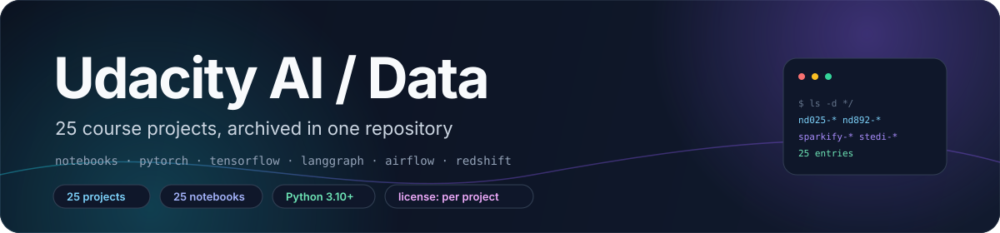
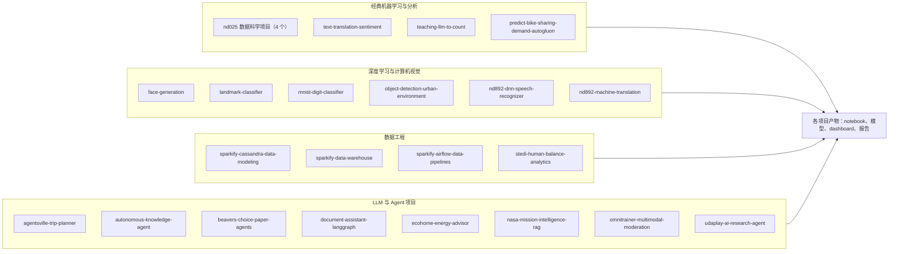

<div align="center">



# udacity-ai-data-projects

**25 个 Udacity AI、数据科学与数据工程课程项目，归档在同一个仓库里。**

一个目录对应一个原仓库 · 每个项目保留自己的 README · notebook、脚本与已提交产物 · 没有统一构建

**简体中文** · [**English**](README.md)

<a href="#-许可证与署名"></a>
<a href="https://www.python.org/"></a>
<a href="docs/projects.md"></a>
<a href="docs/projects.md"></a>

</div>

> [!NOTE]
> **当前状态。** 这是一个归档仓库，不是一个可安装的库。25 个课程项目在 2026-10-21 从各自独立的仓库合并到这里，
> 原仓库随后被删除。根目录没有 `requirements.txt`、没有构建脚本、也没有统一的测试入口；每个项目目录自成一体。

## ✨ 特性

- **25 个顶层项目。** 每个目录都是一个独立仓库，通过 `git subtree` 导入，因此各项目的 commit 历史仍保留在这棵树里。
- **每个项目都有自己的文档。** 24 个项目在目录根部放着 README，`ecohome-energy-advisor/` 的 README 位于
  `ecohome_solution/`；根目录 README 只做索引。
- **以 notebook 为主的课程作业。** 共提交 25 个 `.ipynb`，其中 18 个带有执行输出；部分项目还附上提交用 notebook 导出的 `.html`。
- **rubric 要求的地方有可执行脚本。** `run_demo.py`、`main.py`、`project_starter.py`、`run_gan.py`、
  `run_project.py`、`local_validation.py`、`scripts/run_examples.py`、`report/dashboard.py` 都是真实可运行的文件。
- **依赖横跨多个年代。** 从 `nd892-dnn-speech-recognizer/` 里的 `keras==2.0.5` + `tensorflow==1.1.0`，
  到 `omnitrainer-multimodal-moderation/` 的 Python 3.12 + `uv`。
- **提交了产物。** 训练权重（`.h5`、`.pth`）、一个 LoRA adapter、loss / reward 曲线、Athena 截图、
  多处 `metrics_summary.json`，以及一个 `outputs/inference_video.mp4`。
- **依赖云服务的项目只有文档，不能离线跑。** 三个 Sparkify / STEDI 项目分别面向 Redshift、Airflow 与 AWS Glue。
- **仓库里没有密钥。** 配置一律以 `.env.example`、`env.example` 或占位版 `dwh.cfg` 的形式提交，没有 key 与连接串。

## 🧠 架构

本仓库是 25 个独立项目的合集。下图按课程方向归组；每个项目的命令、产物与限制见 [`docs/projects.md`](docs/projects.md)。



## 🗂️ 项目模块

"课程"一列显示 `—` 表示该项目 README 没有写明所属课程。每一行的安装、运行与产物说明见
[`docs/projects.md`](docs/projects.md)。

| 项目 | 课程 / 模块 | 技术栈 | 入口 |
|---|---|---|---|
| [`agentsville-trip-planner`](agentsville-trip-planner/) | Agentic AI nd900 · Core #6 | openai · pydantic · ReACT 循环 | `agentsville_trip_planner.ipynb` |
| [`autonomous-knowledge-agent`](autonomous-knowledge-agent/) | — | LangGraph · SQLite · pytest | `run_demo.py` |
| [`beavers-choice-paper-agents`](beavers-choice-paper-agents/) | Agentic AI · 多智能体销售 | smolagents · SQLite · pandas | `project_starter.py` |
| [`document-assistant-langgraph`](document-assistant-langgraph/) | — | LangGraph · LangChain · pydantic | `main.py` |
| [`ecohome-energy-advisor`](ecohome-energy-advisor/) | — | LangGraph · ChromaDB · SQLite | `ecohome_solution/run_demo.py` |
| [`face-generation`](face-generation/) | Deep Learning nd101 · Course 5 | PyTorch · DCGAN · CelebA | `run_gan.py` |
| [`landmark-classifier`](landmark-classifier/) | Introduction to Deep Learning · Core #4 | PyTorch · ResNet50 · TorchScript | `cnn_from_scratch.ipynb` |
| [`mnist-digit-classifier`](mnist-digit-classifier/) | Introduction to Deep Learning | PyTorch · 全连接网络 | `mnist_digit_classifier.ipynb` |
| [`nasa-mission-intelligence-rag`](nasa-mission-intelligence-rag/) | — | ChromaDB · Streamlit · RAGAS | `streamlit run chat.py` |
| [`nd025-data-science-blog-post`](nd025-data-science-blog-post/) | Data Scientist nd025 · 博客文章 | pandas · scikit-learn · CRISP-DM | `california_housing_blog_analysis.ipynb` |
| [`nd025-data-science-dashboard`](nd025-data-science-dashboard/) | Data Scientist nd025 · dashboard | FastHTML · SQLite · pytest | `report/dashboard.py` |
| [`nd025-data-science-pipeline`](nd025-data-science-pipeline/) | Data Scientist nd025 · pipeline | scikit-learn · TF-IDF · 网格搜索 | `Data_Science_Pipeline.ipynb` |
| [`nd025-recommendation-system`](nd025-recommendation-system/) | Data Scientist nd025 · 推荐系统 | pandas · scikit-learn · SVD | `Recommendations_with_IBM.ipynb` |
| [`nd892-dnn-speech-recognizer`](nd892-dnn-speech-recognizer/) | NLP nd892 · ASR capstone | Keras 2.0.5 · TF 1.1.0 · librosa | `vui_notebook.ipynb` |
| [`nd892-machine-translation`](nd892-machine-translation/) | NLP nd892 · 机器翻译 | Keras · seq2seq · LSTM/GRU | `machine_translation.ipynb` |
| [`object-detection-urban-environment`](object-detection-urban-environment/) | Self-Driving Car nd013 · Course 2 | TF 2 Detection API · Waymo 帧 | `1_train_model.ipynb` |
| [`omnitrainer-multimodal-moderation`](omnitrainer-multimodal-moderation/) | — | Pydantic AI · FastAPI · Gradio · uv | `uv run multimodal-moderation` |
| [`predict-bike-sharing-demand-autogluon`](predict-bike-sharing-demand-autogluon/) | AWS Machine Learning Engineer | AutoGluon Tabular · SageMaker | `Predict Bike Sharing Demand with AutoGluon.ipynb` |
| [`sparkify-airflow-data-pipelines`](sparkify-airflow-data-pipelines/) | Data Pipelines · Sparkify | Airflow · Redshift · S3 | `dags/final_project.py` |
| [`sparkify-cassandra-data-modeling`](sparkify-cassandra-data-modeling/) | Data Modeling · Cassandra | Cassandra · pandas | `project_1b_solution.py` |
| [`sparkify-data-warehouse`](sparkify-data-warehouse/) | Data Warehouse · Sparkify | Redshift · psycopg2 · boto3 | `etl.py` |
| [`stedi-human-balance-analytics`](stedi-human-balance-analytics/) | Data Engineering with AWS · STEDI | Glue · Athena · Spark | `local_validation.py` |
| [`teaching-llm-to-count`](teaching-llm-to-count/) | Generative AI nd608 · Fundamentals | TRL · PEFT · GRPO · Qwen2.5-0.5B | `run_grpo_mps.py` |
| [`text-translation-sentiment`](text-translation-sentiment/) | Deep Learning nd101 · Course 4 | transformers · MarianMT · DistilBERT | `run_project.py` |
| [`udaplay-ai-research-agent`](udaplay-ai-research-agent/) | — | ChromaDB · OpenAI · Tavily | `scripts/run_examples.py` |

## 🚀 快速开始

**要求：** 较新的项目按各自 README 需要 Python 3.10+；`omnitrainer-multimodal-moderation` 要求 Python 3.12。
`nd892-dnn-speech-recognizer` 仍锁在旧的 Udacity 环境（Python 3.5、`tensorflow==1.1.0`、`keras==2.0.5`）。

仓库层面没有安装步骤：根目录没有 `requirements.txt`、`pyproject.toml` 或 `Makefile`。克隆之后直接进入某个项目目录：

```sh
git clone https://github.com/LeoLin990405/udacity-ai-data-projects.git
cd udacity-ai-data-projects/<project>
python3 -m venv .venv
. .venv/bin/activate
pip install -r requirements.txt
```

下面三个项目不需要云账号就能端到端跑通：

```sh
# 1. LangGraph 客服 Agent —— SQLite 演示，无需 API key
cd autonomous-knowledge-agent
python setup_database.py && python run_demo.py && python -m pytest -q

# 2. 文档助手 —— 没有配置 key 时回退到 FakeDocumentLLM
cd document-assistant-langgraph
cp .env.example .env && python main.py

# 3. 员工事件 dashboard —— 先跑测试，再起服务 http://localhost:5001
cd nd025-data-science-dashboard
pip install -r requirements.txt && pytest && python report/dashboard.py
```

需要账号、key 或 AWS 资源的项目：`sparkify-data-warehouse`（Redshift 集群）、
`sparkify-airflow-data-pipelines`（Airflow 加 Redshift、S3）、`stedi-human-balance-analytics`（Glue 与 Athena）、
`agentsville-trip-planner`（OpenAI 兼容 endpoint），以及需要模型服务 key 的 `nasa-mission-intelligence-rag`、
`udaplay-ai-research-agent`、`omnitrainer-multimodal-moderation`。

> [!TIP]
> 有几个项目内置了确定性回退实现，因此没有凭据也能把流程跑起来看：
> `document-assistant-langgraph/` 的 `FakeDocumentLLM`、`ecohome-energy-advisor/` 的 mock 天气/电价工具
> 加本地 embedding、`udaplay-ai-research-agent/` 的本地 embedding 回退。

## 📊 结果记录

下表每个数字都来自该项目自己的 README、notebook 或 JSON 产物。本次文档整理没有重新运行任何实验。

| 项目 | 记录结果 | 来源 |
|---|---|---|
| `mnist-digit-classifier` | 测试准确率 97.05%（784 → 256 → 128 → 10，15 个 epoch） | 项目 README |
| `nd025-data-science-pipeline` | accuracy 0.8897 · precision 0.9680 · recall 0.8944 · 最佳 CV F1 0.9264 | `metrics_summary.json` |
| `nd025-data-science-blog-post` | 基线线性模型 RMSE 72,188 · MAE 51,845 · R² 0.613（20,640 行） | 项目 README |
| `object-detection-urban-environment` | Faster R-CNN 验证 mAP 0.397，SSD 0.312；最终部署 Faster R-CNN | `experiment_summary.json` |
| `predict-bike-sharing-demand-autogluon` | Kaggle 公开分 1.80412 → 0.67431 → 0.54387（基线、特征、调参） | `report.md` |
| `teaching-llm-to-count` | 8 个计数用例：基座 0/8 → GRPO 训练后 3/8；最终 loss 0.0220 | `results/comparison.json` |
| `agentsville-trip-planner` | ReACT 循环 7 轮，302 USD 行程对比 2,000 USD 预算，5/5 个 rubric 维度 PASS | 已执行 notebook |
| `beavers-choice-paper-agents` | 20 条样例请求、18 次现金余额变动、18 条成功报价/订单回复 | `test_results.csv` |
| `stedi-human-balance-analytics` | `machine_learning_curated` 43,681 行，来自 81,273 行 accelerometer landing 数据 | 项目 README |
| `text-translation-sentiment` | 30 条评论（每语种 10 条）分为 15 条正面 / 15 条负面 | 项目 README |

这些是单人完成的课程提交，不是 benchmark 运行：样本量小，数据划分由 rubric 规定，也没有任何结果为了这份 README 被独立复现。

## 📁 仓库结构

| 路径 | 内容 |
|---|---|
| `README.md` | 本索引与来源说明 |
| `<project>/` ×25 | 一个自成一体的课程项目：notebook、脚本、自己的 README、本地资源 |
| `agentsville-trip-planner/` … `udaplay-ai-research-agent/` | 各项目的技术栈见上方模块表 |
| `document-assistant-langgraph/src/` | LangGraph 状态、工具、检索、schema、fake LLM，以及会话与工具日志 |
| `landmark-classifier/src/` | 数据加载、CNN、优化器、训练、迁移学习、TorchScript 推理 |
| `sparkify-airflow-data-pipelines/` | DAG、四个自定义 operator、SQL helper、`docker-compose.yaml`、截图 |
| `stedi-human-balance-analytics/` | landing 层 DDL、五个 Glue job、校验查询、Athena 截图 |
| `nd025-data-science-dashboard/python-package/` | 可发布的 `employee_events` 包及其 sdist 构建 |
| `omnitrainer-multimodal-moderation/` | 包本体、FastAPI 与 Gradio 应用、eval 套件、`uv.lock` |
| `docs/projects.md` | 逐项目的安装、运行命令、产物与限制 |
| `docs/assets/banner.svg` | 中英文 README 共用的 banner |

## 🛠️ 开发

仓库根目录只有 `README.md` 和项目目录：没有根级测试套件、没有根级 CI、也没有共享的 lint 配置。

```sh
# 每个项目自己的安装方式，实际用到的只有两种
pip install -r requirements.txt          # 大多数项目
uv sync --dev && uv pip install -e .     # omnitrainer-multimodal-moderation

# 五个项目带 pytest 测试
python -m pytest -q                      # autonomous-knowledge-agent
pytest -q                                # document-assistant-langgraph、ecohome-energy-advisor/ecohome_solution
pytest                                  # nd025-data-science-dashboard
uv run pytest tests/ -vv                # omnitrainer-multimodal-moderation
```

- **测试。** 25 个项目里有 5 个带 pytest 套件，其余只有 notebook 和脚本，没有自动化测试。
  `autonomous-knowledge-agent/test_output.txt` 记录了 `Ran 4 tests ... OK`。
- **CI。** 只有 `nd025-data-science-dashboard/.github/workflows/` 真正跑东西：`lint.yml`（flake8）与
  `test.yml`（构建包后跑 pytest），Python 版本 3.10.10。
- **遗留 workflow。** `nd892-dnn-speech-recognizer/` 与 `predict-bike-sharing-demand-autogluon/` 保留了
  Udacity 上游的 `manual.yml`，它用 `JIRA_*` secret 在 PR 上开 Jira ticket，不跑测试，且这些 secret 在这里并不存在。
- **历史。** 每个项目目录里的 `git log` 都能回到原仓库的 commit，所以这棵树里是导入提交，而不是全新的快照。

## 🧭 范围、限制与路线图

这里是课程作业归档，不是生产软件。每个项目由一位作者按 Udacity rubric 完成、随后归档，
没有任何一个被当作库来维护。下面这些内容**无法**为这份 README 验证：

- **没有执行任何东西。** 上面引用的结果都来自已提交的 notebook、`metrics_summary.json`、`test_results.csv`
  与项目 README；本次没有做安装、跑测试或训练。
- **纯云路径。** Redshift、Airflow、Glue 三个项目需要 AWS 资源，这些资源不在仓库里；流程有文档，但没有实际运行。
- **数据集不在仓库里。** `landmark-classifier` 需要本地 `landmark_images/` 目录；CelebA、LibriSpeech（通过 `wget`）
  和 Waymo 帧都在运行时下载。
- **已提交的二进制产物。** `.h5`、`.pth`、`.pickle`、`.p` 都是过去运行留下的输出，没有被重新生成或校验。
- **老旧工具链。** `nd892-dnn-speech-recognizer` 锁定的 Python 3.5 时代包在当前解释器上已无法安装，
  因此该项目可读，但无法按原样复现。
- **原仓库链接已失效。** 多个项目 README 仍指向 `https://github.com/LeoLin990405/<project>` 这些已被删除的独立仓库，
  链接不再可达；这棵树里的副本是目前仅存的来源。

路线图：

- [ ] 把指向已删除独立仓库的链接改为仓库内的相对路径
- [ ] 为每个项目记录当前 Python 下可用的安装命令，或明确标注无法复现
- [ ] 增加依赖审计，让 20 个没有测试的项目至少有一个已知可用的环境
- [ ] 在模块表里直接标出哪些项目需要云账号
- [ ] 为只提交了 `.ipynb` 的项目补上 notebook-as-test 检查

## 🤝 参与贡献

这是一个归档，不是一个活跃项目。文档层面的修正欢迎提：失效链接、跑不通的安装命令、标错的课程。

1. 先开 issue，写清楚项目目录和具体问题；
2. PR 请限定在文档或环境修复，不要重写已提交的课程作业；
3. 永远不要包含 API key、`.env` 文件、Redshift 凭据或 AWS 账号标识。

如果这个归档对你自己的课程项目有参考价值，欢迎点个 ⭐。

## 📄 许可证与署名

**仓库根目录没有 `LICENSE` 文件**，因此整个集合本身没有获得授权。每个目录适用自己的条款，而且彼此不同：

| 目录 | 条款 |
|---|---|
| [`nd025-data-science-dashboard`](nd025-data-science-dashboard/LICENSE.txt) | Udacity Educational Content 许可证（[`LICENSE.txt`](nd025-data-science-dashboard/LICENSE.txt)）——CC BY-NC-ND，正文写"3.0"、链接指向 4.0 版本；禁止商业使用 |
| [`nd025-data-science-pipeline`](nd025-data-science-pipeline/LICENSE.txt) | 同上，Udacity Educational Content 许可证（[`LICENSE.txt`](nd025-data-science-pipeline/LICENSE.txt)） |
| [`predict-bike-sharing-demand-autogluon`](predict-bike-sharing-demand-autogluon/LICENSE.txt) | 同上，Udacity Educational Content 许可证（[`LICENSE.txt`](predict-bike-sharing-demand-autogluon/LICENSE.txt)） |
| [`sparkify-airflow-data-pipelines`](sparkify-airflow-data-pipelines/LICENSE.md) | 同上，Udacity Educational Content 许可证（[`LICENSE.md`](sparkify-airflow-data-pipelines/LICENSE.md)） |
| [`nd892-dnn-speech-recognizer`](nd892-dnn-speech-recognizer/LICENSE.txt) | MIT，"Copyright (c) 2017 Udacity, Inc."（[`LICENSE.txt`](nd892-dnn-speech-recognizer/LICENSE.txt)） |
| [`omnitrainer-multimodal-moderation`](omnitrainer-multimodal-moderation/pyproject.toml) | `pyproject.toml` 声明 `license = "MIT"`；该目录内无 LICENSE 文件 |
| [`teaching-llm-to-count`](teaching-llm-to-count/README.md) | 项目 README 写明 `MIT`；该目录内无 LICENSE 文件 |
| 其余 18 个目录 | 没有 LICENSE 文件，也没有声明条款 |

署名与被借用的材料：

- **课程框架。** 各项目 README、rubric、starter 文件与 `CODEOWNERS` 来自 Udacity nanodegree 材料；
  Udacity 的版权声明保留在上面四个许可证文件中。
- **借用代码。** `nd892-dnn-speech-recognizer/create_desc_json.py` 与 `flac_to_wav.sh`（以及部分 spectrogram 辅助函数）
  取自 [baidu-research/ba-dls-deepspeech](https://github.com/baidu-research/ba-dls-deepspeech)，见该项目 README。
- **数据集。** California housing 来自 Hands-On Machine Learning 仓库（`nd025-data-science-blog-post/`）；
  CelebA 属性通过 Hugging Face `tpremoli/CelebA-attrs` 数据集获取（`face-generation/`）；LibriSpeech 来自 OpenSLR
  （`nd892-dnn-speech-recognizer/`）；NASA Apollo 11、Apollo 13、Challenger 转录稿（`nasa-mission-intelligence-rag/data_text/`）；
  IBM Watson Studio 文章数据（`nd025-recommendation-system/data/`）；STEDI starter 数据复制自
  [Udacity nd027 starter 仓库](https://github.com/udacity/nd027-Data-Engineering-Data-Lakes-AWS-Exercises/tree/main/project/starter)
  （`stedi-human-balance-analytics/data/starter/`）。

## ⭐ Star 历史

<div align="center">

<a href="https://star-history.com/#LeoLin990405/udacity-ai-data-projects&Date">
  
</a>

</div>
