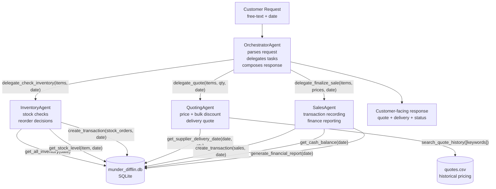

# Beaver's Choice — Multi-Agent Workflow Diagram

## High-level architecture (4 agents, ≤5 cap)

## Agent responsibilities

| Agent | Inputs | Outputs | Tools (helpers used) |
|-------|--------|---------|---------------------|
| **OrchestratorAgent** | raw customer request + date | sanitized customer response | delegate_* tools wrapping the 3 worker agents |
| **InventoryAgent** | item list + qty + date | per-item availability ✅ / partial / reorder needed | `get_all_inventory`, `get_stock_level`, `get_supplier_delivery_date`, `create_transaction` (for stock-purchase events) |
| **QuotingAgent** | items + qty + date | unit price + bulk discount + final price + ETA | `search_quote_history`, `get_supplier_delivery_date` |
| **SalesAgent** | items + final prices + qty + date | transaction confirmation + post-sale cash balance | `create_transaction` (for sales), `get_cash_balance`, `generate_financial_report` |

All 7 mandated helper functions are exercised across the 4 agents.

## Decision logic

1. **OrchestratorAgent** parses the free-text request via prompt-engineered LLM (Chain-of-Thought + few-shot).
2. **InventoryAgent**: if `get_stock_level(item, date) >= qty` → fulfillable; if `< qty` → check `get_supplier_delivery_date` for restock window; if `== 0` and supplier ETA > customer deadline → mark unfulfillable.
3. **QuotingAgent**: base unit price from `paper_supplies`; bulk discount tiers (5% @ 500 units, 10% @ 1000, 15% @ 5000); `search_quote_history` to align with historical pricing.
4. **SalesAgent**: only creates a "sales" transaction for fulfilled lines; updates cash via `create_transaction(... transaction_type='sales' ...)`.
5. Customer response is composed by orchestrator — ordered breakdown + total + ETA + (if applicable) reasons for unfulfilled items.
