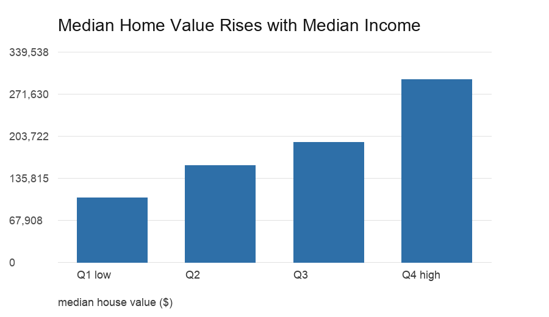
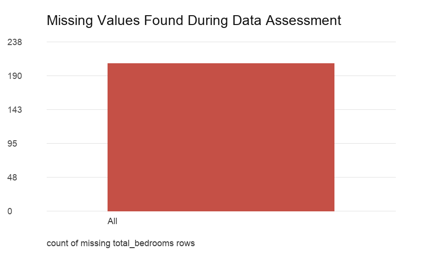
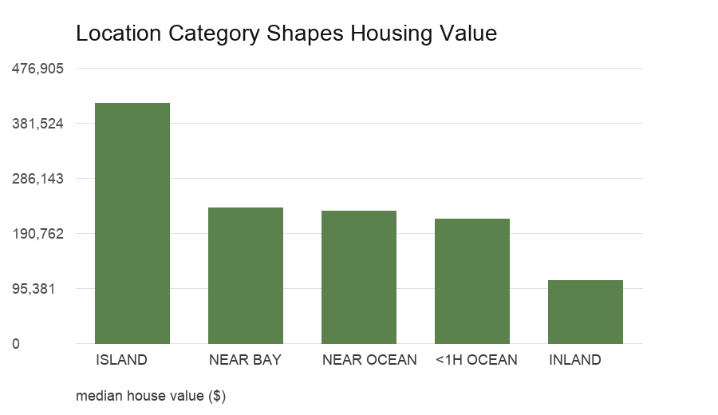
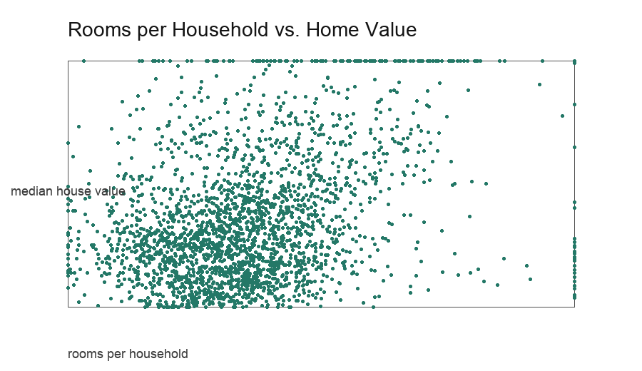

# What Drives California Housing Prices?

Housing prices can feel mysterious, but a careful look at the data reveals patterns that are useful for analysts, civic planners, and product teams building housing tools. I analyzed 20,640 California block-group records to understand what drives median house value.

## 1. Is the data complete enough to trust?

The dataset is mostly complete. The main quality issue is 207 missing `total_bedrooms` values. Because those missing records represent a small share of the data, I used median imputation when creating bedroom-related ratio features.

## 2. Does income explain housing value?

Yes, income is the strongest single signal in this analysis. Median home value increases substantially from the lowest median-income quartile to the highest quartile. This does not mean income alone determines value, but it gives stakeholders a clear first-order explanation.

## 3. Does location still matter?

Location matters a great deal. Broad location categories show that ocean-adjacent and bay-adjacent block groups have higher median values than inland areas. This confirms that geographic desirability remains important even before adding detailed neighborhood features.

## 4. Can a simple model help?

A transparent linear baseline produced RMSE $72,188, MAE $51,845, and R² 0.613. That is useful as an interpretable benchmark, but it should not be used as a production appraisal model. A production system would need more granular geography, current market data, and fairness checks.

## Final Takeaway

California housing value is shaped by a combination of income, location, and household-level density. The most practical stakeholder lesson is to avoid one-variable explanations: a useful model should combine socioeconomic signals, location context, and engineered housing features.
