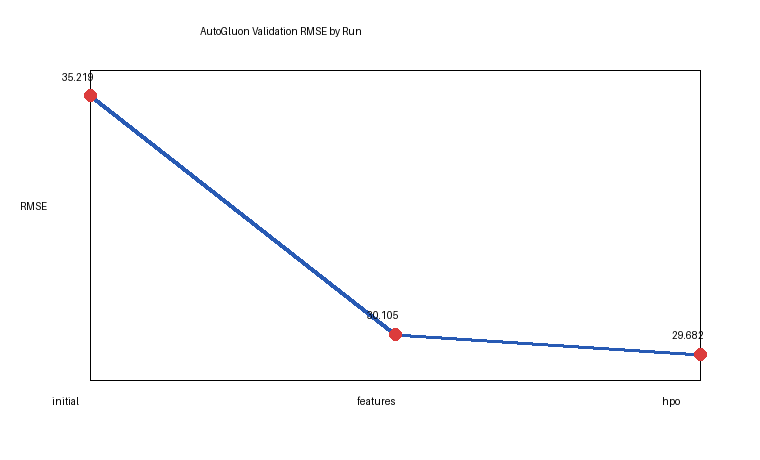
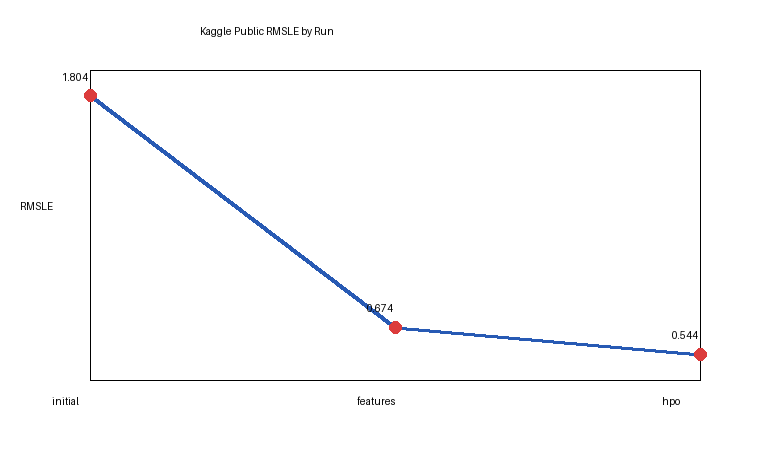

# Report: Predict Bike Sharing Demand with AutoGluon Solution
#### Lin Zhongyue

## Initial Training
### What did you realize when you tried to submit your predictions? What changes were needed to the output of the predictor to submit your results?
The first AutoGluon model produced a small number of negative predictions, but Kaggle expects non-negative demand counts. I clipped every prediction below zero to zero before writing `submission.csv`. I also dropped `casual` and `registered` from training because they are leakage columns that sum to the target and are not available in the test set.

### What was the top ranked model that performed?
The best validation model in the initial run was `WeightedEnsemble_L3`, which combined several bagged base learners. Its validation RMSE was 35.2187 and the Kaggle public score was 1.80412.

## Exploratory data analysis and feature creation
### What did the exploratory analysis find and how did you add additional features?
The raw dataset contained a datetime column, but the initial model could not directly use its cyclic and calendar structure. Histograms and grouped checks showed strong demand changes by hour, month, workday, and weather. I extracted `hour`, `day`, `month`, `year`, and `dayofweek`, then cast calendar, weather, season, holiday, and working-day fields to categorical types.

### How much better did your model perform after adding additional features and why do you think that is?
The public Kaggle score improved from 1.80412 to 0.67431. The improvement came mostly from making hour-of-day and calendar seasonality explicit, because bike rentals are highly dependent on commuting patterns and day/night usage.

## Hyper parameter tuning
### How much better did your model perform after trying different hyper parameters?
The tuned run improved the Kaggle public score from 0.67431 to 0.54387. The improvement was smaller than the feature-engineering jump, but the expanded GBM, CatBoost, XGBoost, and random forest search gave the ensemble more diverse learners.

### If you were given more time with this dataset, where do you think you would spend more time?
I would spend more time on feature engineering around cyclic encodings for hour and month, outlier handling for unusual weather days, and ensembling models trained on log-transformed demand. I would also run longer AutoGluon time limits and compare leaderboard stability between validation and Kaggle public scores.

### Create a table with the models you ran, the hyperparameters modified, and the kaggle score.
| model | hpo1 | hpo2 | hpo3 | score |
| -- | -- | -- | -- | -- |
| initial | presets='best_quality' | time_limit=600 | default model zoo | 1.80412 |
| add_features | datetime features | categorical casts | time_limit=900 | 0.67431 |
| hpo | GBM/CAT/XGB/RF search | extra_trees GBM | time_limit=1200 | 0.54387 |

### Create a line plot showing the top model score for the three training runs during the project.

### Create a line plot showing the top kaggle score for the three prediction submissions during the project.

## Summary
The project showed that AutoGluon can produce a working baseline quickly, but thoughtful feature engineering matters most for this tabular time-dependent problem. Extracting calendar features reduced the Kaggle score substantially, and a targeted hyperparameter search added a smaller additional gain. The final model used non-negative predictions, avoided target leakage, included explicit time features, and achieved the best public score of 0.54387 among the three submitted runs.
